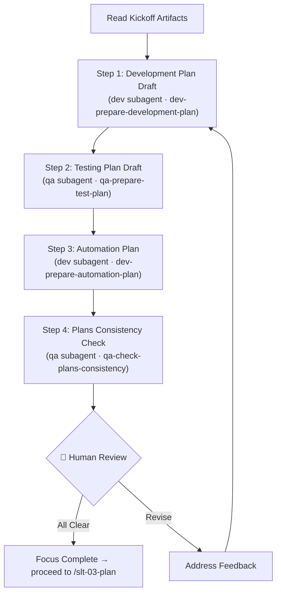

# Stage 02 — Focus

This stage is to focus on preparing for the implementation, basing on the refined requirements. Build draft plans for implementation, testing, and test automation, then verify that the drafts are consistent before the final plan is compiled.

**Input**: Kickoff artifacts from `my-specs/tasks/<short-name>/` produced at the previous stage. The user provides the `<short-name>` or the path to the task directory.

**Argument:** `$ARGUMENTS` — the task `<short-name>` (or the path to the task directory) used throughout this command.

---

## Prerequisite Artifacts

Read the following files before starting:

- `my-specs/tasks/<short-name>/01-business-idea.md`
- `my-specs/tasks/<short-name>/01-implementation-scope.md`
- `my-specs/tasks/<short-name>/01-kickoff-checklist.md`

If any of these are missing, stop and tell the user to run `/slt-01-kickoff` first.

---

## Workflow Diagram



---

## Steps

Work through these steps sequentially. Present all results to the user for review after completing all steps.

### Step 1 — Development Plan Draft

Use the `subagent` tool with agent ID `dev` to delegate to the Senior Full-Stack Developer subagent. Instruct it to load the `dev-prepare-development-plan` skill (call the `skill` tool with id `dev-prepare-development-plan`).

Pass all kickoff artifacts together with the request:
```
Prepare a development plan draft based on the provided kickoff artifacts.
```

Save the result as `my-specs/tasks/<short-name>/02-development-plan.md`.

Append a `## Summary` section at the bottom of the file with 3–5 bullet points capturing the proposed approach, key implementation decisions, and main risks.

### Step 2 — Testing Plan Draft

Use the `subagent` tool with agent ID `qa` to delegate to the QA Expert subagent. Instruct it to load the `qa-prepare-test-plan` skill (call the `skill` tool with id `qa-prepare-test-plan`).

Pass all kickoff artifacts plus the development plan along to the request:
```
Prepare a testing plan draft based on the kickoff artifacts and the development plan draft.
```

Save the result as `my-specs/tasks/<short-name>/02-testing-plan.md`.

Append a `## Summary` section at the bottom of the file with 3–5 bullet points capturing the testing strategy, coverage priorities, and identified risks.

### Step 3 — Test Automation Plan

Use the `subagent` tool with agent ID `dev` to delegate to the Senior Full-Stack Developer subagent. Instruct it to load the `dev-prepare-automation-plan` skill (call the `skill` tool with id `dev-prepare-automation-plan`).

Pass the kickoff artifacts, development plan, and testing plan along to the request:
```
Prepare a test automation plan based on the provided kickoff artifacts and planning drafts.
```

Save the result as `my-specs/tasks/<short-name>/02-automation-plan.md`.

Append a `## Summary` section at the bottom of the file with 3–5 bullet points capturing the automation approach, selected tools, and test pyramid decisions.

### Step 4 — Plans Consistency Check

Use the `subagent` tool with agent ID `qa` to delegate to the QA Expert subagent. Instruct it to load the `qa-check-plans-consistency` skill (call the `skill` tool with id `qa-check-plans-consistency`).

Pass all artifacts produced so far:
```
Check the consistency of all planning artifacts against the kickoff artifacts.
```

Save the result as `my-specs/tasks/<short-name>/02-focus-checklist.md`.

Append a `## Summary` section at the bottom of the file with 3–5 bullet points capturing the consistency verdict, critical gaps between plans, and required corrections.

**🛑 Checkpoint:** Present all four artifacts (development plan, testing plan, automation plan, consistency check) to the user. Address any feedback before proceeding to the next stage.

---

## Output Artifacts

| File | Content |
|------|---------|
| `02-development-plan.md` | Draft implementation plan |
| `02-testing-plan.md` | Draft testing plan |
| `02-automation-plan.md` | Draft test automation plan |
| `02-focus-checklist.md` | Cross-artifact consistency checklist |

All files are saved in `my-specs/tasks/<short-name>/`.

---

## Rules

- Read all existing kickoff artifacts before starting any planning work
- Each step builds on the previous — pass accumulated artifacts forward
- Use only information from the kickoff artifacts and codebase — do not invent requirements
- If consistency gaps are found, address them before declaring Focus complete
