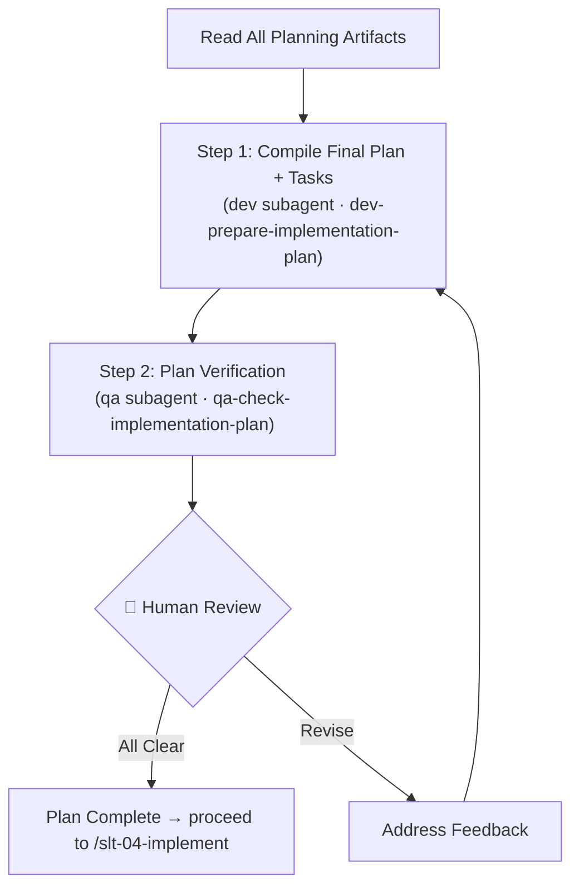

# Stage 03 — Plan

Compile the approved planning drafts into the final implementation plan with an executable task list, then verify the plan is ready for implementation.

**Input**: All artifacts from previous stages in `my-specs/tasks/<short-name>/`. The user provides the `<short-name>` or the path to the task directory.

**Argument:** `$ARGUMENTS` — the task `<short-name>` (or the path to the task directory) used throughout this command.

---

## Prerequisite Artifacts

Check the existence of the following files before starting:

- `my-specs/tasks/<short-name>/01-business-idea.md`
- `my-specs/tasks/<short-name>/01-implementation-scope.md`
- `my-specs/tasks/<short-name>/01-kickoff-checklist.md`
- `my-specs/tasks/<short-name>/02-development-plan.md`
- `my-specs/tasks/<short-name>/02-testing-plan.md`
- `my-specs/tasks/<short-name>/02-automation-plan.md`
- `my-specs/tasks/<short-name>/02-focus-checklist.md`

If any of these are missing, stop and tell the user to run the earlier workflow stages first.

## Planning Artifacts

Use these planning artifacts from the previous stage to compile the final implementation plan and task list. Start your work by reading them:
- `my-specs/tasks/<short-name>/02-development-plan.md`
- `my-specs/tasks/<short-name>/02-testing-plan.md`
- `my-specs/tasks/<short-name>/02-automation-plan.md`

---

## Workflow Diagram



---

## Steps

Work through these steps sequentially. Present all results to the user for review after completing all steps.

### Step 1 — Compile the Final Implementation Plan and Tasks

Use the `subagent` tool with agent ID `dev` to delegate to the Senior Full-Stack Developer subagent. Instruct it to load the `dev-prepare-implementation-plan` skill (call the `skill` tool with id `dev-prepare-implementation-plan`).

Pass all planning artifacts and ask:
```
Compile the final implementation plan and executable task list from all approved planning artifacts.
```

The skill produces two coordinated outputs. Save them as:
- `my-specs/tasks/<short-name>/03-implementation-plan.md`
- `my-specs/tasks/<short-name>/03-tasks.md`

Append a `## Summary` section at the bottom of each file with 3–5 bullet points: for the implementation plan, capture the delivery stages and main risks; for the task list, capture the total task count, stage grouping, and key milestones.

### Step 2 — Verify the Implementation Plan

Use the `subagent` tool with agent ID `qa` to delegate to the QA Expert subagent. Instruct it to load the `qa-check-implementation-plan` skill (call the `skill` tool with id `qa-check-implementation-plan`).

Pass the final plan, task list, and all upstream planning artifacts:
```
Verify the final implementation plan and task list for completeness, alignment, and execution readiness.
```

Save the result as `my-specs/tasks/<short-name>/03-plan-checklist.md`.

Append a `## Summary` section at the bottom of the file with 3–5 bullet points capturing the verification verdict, critical issues found, and implementation readiness status.

**🛑 Checkpoint:** Present the implementation plan, task list, and plan verification checklist to the user. Address any feedback before proceeding to implementation.

---

## Output Artifacts

| File | Content |
|------|---------|
| `03-implementation-plan.md` | Final implementation plan with delivery stages |
| `03-tasks.md` | Executable task list grouped by stage |
| `03-plan-checklist.md` | QA verification checklist for the plan |

All files are saved in `my-specs/tasks/<short-name>/`.

---

## Rules

- Read all upstream artifacts before compiling the plan
- Do not drop requirements, testing work, or non-coding tasks from the incoming drafts
- Group implementation work into stages identified by product architecture layers
- Keep tasks specific enough to execute and verify
- Do not proceed to implementation until the human has approved the plan and the QA check is clear
