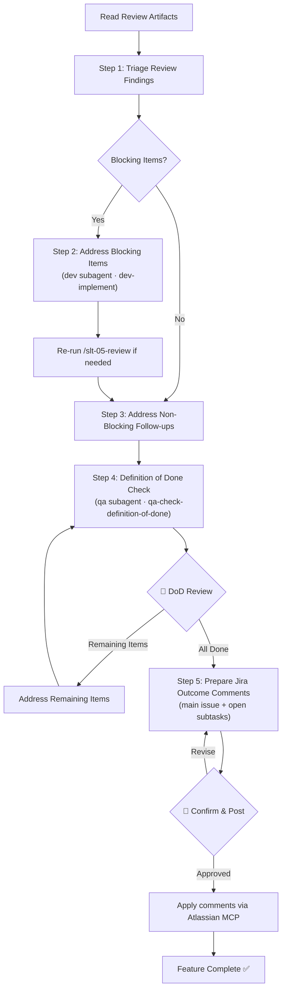

# Stage 06 — Polish

Address review follow-ups, complete any remaining work, and run the Definition of Done checklist to confirm the feature is ready to close.

**Input**: All task artifacts from `my-specs/tasks/<short-name>/`. The user provides the `<short-name>` or the path to the task directory.

**Argument:** `$ARGUMENTS` — the task `<short-name>` (or the path to the task directory) used throughout this command.

---

## Prerequisite Artifacts

Read the following files before starting:

- `my-specs/tasks/<short-name>/03-implementation-plan.md`
- `my-specs/tasks/<short-name>/03-tasks.md`
- `my-specs/tasks/<short-name>/05-review-summary.md`

If review artifacts are missing, stop and tell the user to run `/slt-05-review` first.

---

## Workflow Diagram



---

## Steps

### Step 1 — Triage Review Findings

Read review artifacts and categorize findings:
1. **Blocking** — must be fixed before closure
2. **Non-blocking follow-ups** — should be addressed or explicitly deferred
3. **Deferred improvements** — intentionally left for future work

Present the triage to the user.

### Step 2 — Address Blocking Items (if any)

If there are blocking findings, use the `subagent` tool with agent ID `dev` to delegate to the Senior Full-Stack Developer subagent. Instruct it to load the `dev-implement` skill (call the `skill` tool with id `dev-implement`).

```
Address the following blocking review findings.
```

After fixes are applied, suggest the user re-run `/slt-05-review` to verify the fixes if the changes are substantial.

**🛑 Checkpoint:** Confirm all blocking items are resolved. Present the fixes to the user.

### Step 3 — Address Non-Blocking Follow-ups

For each non-blocking follow-up, either:
- Apply the fix if it's straightforward
- Create a follow-up task note if it should be deferred

Update `05-review-summary.md` to reflect the final state of all tasks: set `[x]` for completed items and `[ ]` for remaining items. You can update the checklist with new items if they were discovered during the polish stage.

### Step 4 — Definition of Done Check

Use the `subagent` tool with agent ID `qa` to delegate to the QA Expert subagent. Instruct it to load the `qa-check-definition-of-done` skill (call the `skill` tool with id `qa-check-definition-of-done`).

Pass the implementation plan (`03-implementation-plan.md`), final task status (`04-tasks-progress.md`), review artifacts (`05-review-summary.md`), and any evidence about PR state, documentation, or remaining work:
```
Evaluate whether the feature is ready to close. Check review follow-ups, remaining tasks, and closure obligations.
```

Save the result as `my-specs/tasks/<short-name>/06-done-checklist.md`.

Append a `## Summary` section at the bottom of the file with 3–5 bullet points capturing the DoD verdict, remaining open items, and final feature readiness status.

**🛑 Checkpoint:** Present the done checklist to the user. If items remain open, the user will address them and re-run the check. When all items are resolved, proceed to Step 5 to record outcomes in Jira.

### Step 5 — Prepare and Apply Jira Outcome Comments

Only if the task is associated with a Jira issue (skip with a note otherwise). Using the Atlassian MCP, identify the **main Jira issue** and its **open subtasks** (the DoD check in Step 4 already gathered this).

For the main issue and **each** open subtask, draft a short, concise **Outcome** comment that summarizes:
- **What was done** in that specific issue/subtask (scope of the change, grounded in the implementation and review artifacts).
- **Any special details** that matter for follow-up or for understanding **why it was done this way** — non-obvious decisions, trade-offs, deferred items, or caveats. Omit this part when there is nothing noteworthy; keep each comment tight.

Save all drafted comments to `my-specs/tasks/<short-name>/06-outcome-comments.md`, grouped by issue key, so there is a local record.

**🛑 Checkpoint:** Present the drafted comments mapped to their issue keys for the user to confirm or revise. Posting to Jira is outward-facing and not easily undone, so do not post before the user approves. Once approved, apply each comment to its issue via the Atlassian MCP (`addCommentToJiraIssue`), then report which issues were commented. The feature is complete once outcomes are recorded.

---

## Output Artifacts

| File | Content |
|------|---------|
| `06-done-checklist.md` | Definition of Done checklist with gaps summary |
| `06-outcome-comments.md` | Drafted per-issue Jira outcome comments (main issue + open subtasks) |
| `04-tasks-progress.md` | Updated with final task statuses |
| `05-review-summary.md` | Updated with final review findings |

All files are saved in `my-specs/tasks/<short-name>/`.

---

## Rules

- Do not skip blocking findings — they must be resolved or explicitly accepted by the human
- Update task status to reflect reality, not intent
- Non-blocking items may be deferred but must be documented
- The feature is not done until the DoD checklist passes or the human explicitly accepts remaining gaps
- Outcome comments must be concise and grounded in the actual work — summarize what was done per issue plus only the follow-up/rationale details that genuinely matter
- Never post Jira comments before the human approves them; if no Jira issue is associated, skip Step 5 and note it
