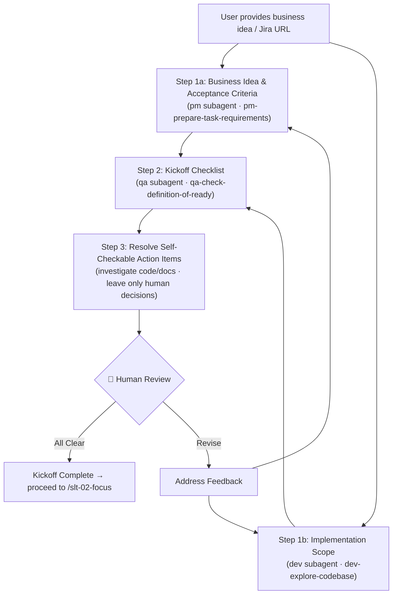

# Stage 01 — Kickoff

Explore and collect the details of the business idea and its implementation. Produce structured kickoff artifacts in `my-specs/tasks/<short-name>/`.

**Input**: A business idea, feature request, improvement requirement, or a Jira issue URL. Additional context may be attached as files.

---

## Workflow Diagram



---

## Steps

Run Steps 1a and 1b in parallel by issuing two `Task` tool calls in a **single message** (one with `subagent_type: pm`, one with `subagent_type: dev`). Once both complete, proceed to Step 2. Present all results to the user for review after completing all steps.

### Step 1a — Identify the Business Idea and Acceptance Criteria

Use the `Task` tool with `subagent_type: pm` to delegate to the Product Manager subagent. It's assumed to apply the `pm-prepare-task-requirements` skill.

Pass all information the user gave you, including any attached files, URLs, etc., along with the request:
```
Formulate **what** the business idea is, **why** it matters, and define the acceptance criteria for the task.
Discover the **broader context**: a task is usually part of a bigger activity. If this is a Jira issue, follow its parent and linked issues (and any Confluence pages they reference) via the Atlassian MCP to establish the larger initiative it belongs to. Record this under "Broader Context & Parent Activity". If no broader context or parent issue can be established, state that explicitly — do not invent one.
```

Save the result as `my-specs/tasks/<short-name>/01-business-idea.md`.

Append a `## Summary` section at the bottom of the file with 3–5 bullet points capturing the business idea essence, main acceptance criteria, and any open questions.

### Step 1b — Define Implementation Scope

Use the `Task` tool with `subagent_type: dev` to delegate to the Senior Full-Stack Developer subagent. It's assumed to apply the `dev-explore-codebase` skill.

Pass all information the user gave you, including any attached files, URLs, etc., along with the request:
```
Investigate the codebase and define the implementation scope:
- **What** should be changed in the product
- **How** it should be changed (the substance of the business idea)
- **Where** in the code — preliminary view of the places that need modification
- Research the existing code responsible for the problem area
  - NOTE: it may appear that relevant code doesn't exist if the requested functionality is new
- Use ASCII diagrams actively to visualize the explored implementation ideas (architecture sketches, data/control flow, component interactions, before/after states, dependency graphs). A good diagram conveys the change shape faster than paragraphs.
```

Save the result as `my-specs/tasks/<short-name>/01-implementation-scope.md` with this structure:

```
# Implementation Scope: <title>
## Changes Overview
## Affected Areas
## Code Investigation
### Relevant Files and Components
### Existing Patterns
## Preliminary Change Plan
```

Append a `## Summary` section at the bottom of the file with 3–5 bullet points capturing the main areas of change, key findings, and preliminary change direction. **Include at least one ASCII diagram in this section** that showcases the explored implementation idea(s) at a glance — e.g., the proposed flow, the affected components and how they connect, or a before/after sketch.

### Step 2 — Kickoff Checklist

Use the `Task` tool with `subagent_type: qa` to delegate to the QA Expert subagent. It's assumed to apply the `qa-check-definition-of-ready` skill.

Pass the business idea and implementation scope artifacts together:
```
Evaluate the kickoff artifacts for readiness. Mark each checklist item, provide evidence-based answers, and summarize any gaps.
```

Save the result as `my-specs/tasks/<short-name>/01-kickoff-checklist.md`.

Append a `## Summary` section at the bottom of the file with 3–5 bullet points capturing the overall readiness verdict, critical gaps, and recommended actions.

### Step 3 — Resolve Self-Checkable Action Items

Before the checkpoint, review `01-kickoff-checklist.md` and triage every open action item, gap, or question:

- **Self-checkable** — anything you can resolve yourself by investigating the codebase, reading documentation, or checking existing artifacts (e.g., "is there an existing API for X?", "does pattern Y already exist?", "is field Z stored?"). Investigate it now (delegate to the `dev` subagent for code/doc checks where appropriate), then update the checklist item with the finding and mark it resolved.
- **Needs human decision** — anything that depends on product intent, business priorities, external stakeholders, or trade-offs you cannot determine from the code or docs. Leave these for human review.

Only genuinely human-dependent items should remain open when you reach the checkpoint. Re-save `01-kickoff-checklist.md` with the resolved items updated.

**🛑 Checkpoint:** Present all three artifacts (business idea, implementation scope, kickoff checklist) to the user. Clearly call out which checklist items you resolved yourself and which remain open for their decision. Address any feedback before proceeding to the next stage.

---

## Output Artifacts

| File | Content |
|------|---------|
| `01-business-idea.md` | Business idea summary + acceptance criteria |
| `01-implementation-scope.md` | Codebase investigation + scope definition |
| `01-kickoff-checklist.md` | Readiness checklist with gaps summary |

All files are saved in `my-specs/tasks/<short-name>/`.

---

## Rules

- Derive `<short-name>` as kebab-case from the business idea title with Jira issue key, if provided (e.g., "Add Two-Factor Auth" → `JIRA-123-add-two-factor-auth`)
- Present the name to the user for confirmation
- Create the task directory `my-specs/tasks/<short-name>/` at the start
- Prepare and provide each document to the next step
- Use only information from the provided input and codebase investigation — do not invent requirements
- If information is missing, flag it explicitly in the kickoff checklist (Step 2)
