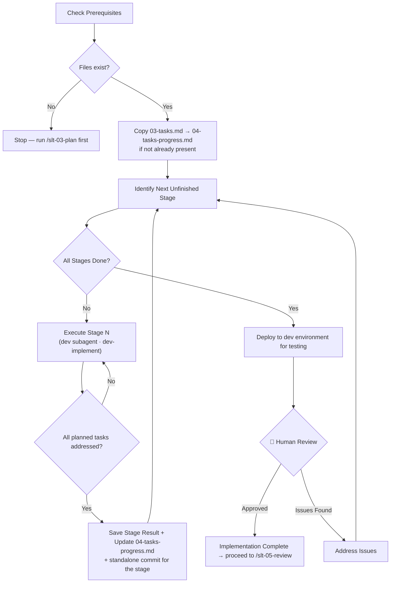

# Stage 04 — Implement

Execute the remaining implementation stages from the approved plan one stage at a time, committing each stage as it completes. Once all stages are done, deploy the changes to the dev environment for testing, then report the outcome for a single human review at the end.

**Input**: The approved implementation plan and task list from `my-specs/tasks/<short-name>/`. The user provides the `<short-name>` or the path to the task directory.

---

## Prerequisite Artifacts

Check that the following files exist before starting:

- `my-specs/tasks/<short-name>/03-implementation-plan.md`
- `my-specs/tasks/<short-name>/03-tasks.md`

If either is missing, stop and tell the user to run `/slt-03-plan` first.

If `my-specs/tasks/<short-name>/04-tasks-progress.md` does not yet exist, copy `03-tasks.md` to `04-tasks-progress.md`. This copy serves as the working checklist — mark tasks done here as stages are completed.

Then read:

- `my-specs/tasks/<short-name>/03-implementation-plan.md`
- `my-specs/tasks/<short-name>/04-tasks-progress.md`

---

## Workflow Diagram



---

## Steps

### Step 1 — Determine Current Progress

Read the task progress checklist (`04-tasks-progress.md`) to determine which implementation stage is next.

If all stages are already complete, skip to Step 3 (deploy) and then the final checkpoint.

### Step 2 — Execute the Remaining Stages, One Stage at a Time

Work through the unfinished stages **sequentially, looping until none remain**. There is **no human review between stages** — only at the very end (Step 4). For each unfinished stage, repeat 2a → 2b → 2c, then move to the next stage:

**2a — Execute the stage.** Use the `Task` tool with `subagent_type: dev` to delegate to the Senior Full-Stack Developer subagent. It's assumed to apply the `dev-implement` skill.

Pass the implementation plan (`03-implementation-plan.md`), current progress state (`04-tasks-progress.md`), and the stage to be implemented (`Stage N`):
```
Execute only tasks from the next unfinished stage in the implementation plan, including its version-control task (standalone commit, or branch create/merge where the plan specifies one).
```

**2b — Verify stage completeness.** Compare the stage result against the tasks planned for this stage in `04-tasks-progress.md`. Check that every task assigned to this stage was addressed — either completed or explicitly flagged as blocked, **including the stage's commit/branch task** from the version control strategy. If any planned tasks were missed, ask the dev subagent to complete them before moving on.

**2c — Update task progress.** Based on the stage result:
1. Mark completed tasks in `04-tasks-progress.md` — change `[ ]` to `[x]` for each task the stage result confirms as done.
2. Note any blockers or open questions.

**Stop the loop early only if a stage is blocked** in a way that prevents safe continuation; in that case, report the blocker at the final checkpoint instead of proceeding.

### Step 3 — Deploy to the Dev Environment for Testing

Once all stages are complete, deploy/synchronize the implemented changes to the dev environment so the feature can be tested. Apply appropriate skill to perform the sync.

If no dev-environment sync is configured or the skill is unavailable, do not block — note this in the report and let the user deploy manually.

### Step 4 — Final Review

**🛑 Checkpoint:** Present the overall implementation result to the user: what was built across all stages, the per-stage commits made, which checks/tests passed, the dev-environment deployment outcome, and any blockers or open questions. The user decides whether to proceed to review (`/slt-05-review`) or address issues first.

---

## Output Artifacts

| File | Content |
|------|---------|
| `04-tasks-progress.md` | Working copy of task list with checked-off completed tasks |

All files are saved in `my-specs/tasks/<short-name>/`.

---

## Rules

- Implement stages sequentially, one at a time, but continue automatically through all remaining stages without pausing for human review between them
- Commit each stage as its own standalone commit (or branch, where the plan specifies one) as part of executing that stage
- Deploy to the dev environment only after all stages are complete, before the final review
- Do not make changes to any incoming planning artifacts
- Report non-coding tasks or any issues or open questions in the final result for the human to handle
- If the plan is missing detail needed for safe implementation, raise that gap instead of guessing — and stop the loop if continuing would be unsafe
