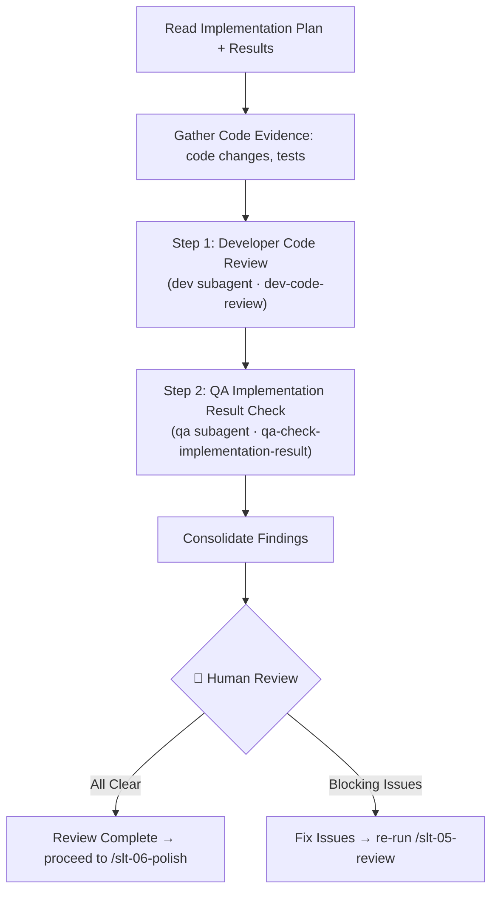

# Stage 05 — Review

Run a developer code review and a QA implementation-result check on the delivered work, then present consolidated findings to the user.

**Input**: Implementation artifacts from `my-specs/tasks/<short-name>/`. The user provides the `<short-name>` or the path to the task directory.

---

## Prerequisite Artifacts

Read the following files before starting:

- `my-specs/tasks/<short-name>/03-implementation-plan.md`
- `my-specs/tasks/<short-name>/03-tasks.md`
- All `my-specs/tasks/<short-name>/04-tasks-progress.md` files

**Checkpoint**: If the implementation plan or task progress files are missing, stop and tell the user to run earlier stages first.

Additionally, gather the current code evidence:
- Current branch, changes (whether staged or unstaged) or PR diff for the implemented work
- Test or check output if available

---

## Workflow Diagram



---

## Steps

### Step 1 — Developer Code Review

Use the `Task` tool with `subagent_type: dev` to delegate to the Senior Full-Stack Developer subagent. It's assumed to apply the `dev-code-review` skill.

Pass the implementation plan and code evidence (current branch, changes, or PR diff usually available via Git):
```
Review the implementation against the approved plan. Focus on correctness, scope alignment, maintainability, and missing tests. Separate blocking findings from improvements.
```

Save the result as `my-specs/tasks/<short-name>/05-dev-review.md`.

Append a `## Summary` section at the bottom of the file with 3–5 bullet points capturing the review verdict, blocking findings count, and most critical issues.

### Step 2 — QA Implementation Result Check

Use the `Task` tool with `subagent_type: qa` to delegate to the QA Expert subagent. It's assumed to apply the `qa-check-implementation-result` skill.

Pass the implementation plan with task list, progress, and code evidence (current branch, changes, or PR diff usually available via Git):
```
Compare the delivered implementation against the approved plan and the available execution evidence. Mark each checklist item and summarize gaps.
```

Save the result as `my-specs/tasks/<short-name>/05-qa-review.md`.

Append a `## Summary` section at the bottom of the file with 3–5 bullet points capturing the QA assessment, gaps found, and overall implementation quality verdict.

### Step 3 — Consolidate and Present

Combine the developer review and QA check into a review summary:
1. List all **blocking findings** from both reviews
2. List all **important findings** that should be addressed
3. List **nice-to-have improvements** that can be deferred
4. Provide a clear **verdict**: ready to polish, or needs rework
5. Append a `## Summary` section at the bottom with 3–5 bullet points capturing the overall verdict, count of blocking vs. non-blocking items, and recommended next action.

Save the result as `my-specs/tasks/<short-name>/05-review-summary.md`. Treat it as a checklist: set `[x]` for items that are done and `[ ]` for items to be done.

**🛑 Checkpoint:** Present the consolidated review to the user. The user decides whether to:
- Fix blocking issues and re-run `/slt-05-review`
- Accept the findings and proceed to `/slt-06-polish`

---

## Output Artifacts

| File | Content |
|------|---------|
| `05-dev-review.md` | Developer code review report |
| `05-qa-review.md` | QA implementation result checklist |
| `05-review-summary.md` | Consolidated review summary |
All files are saved in `my-specs/tasks/<short-name>/`.

---

## Rules

- Run both the developer review and QA check before presenting findings
- Use an implementation-independent reviewer perspective — review as a critic, not as the implementer
- Compare the result against the approved plan, not against imagined future work
- Do not implement fixes inside the review — only report findings
- If evidence is missing (no diff, no test output), ask for it instead of guessing
