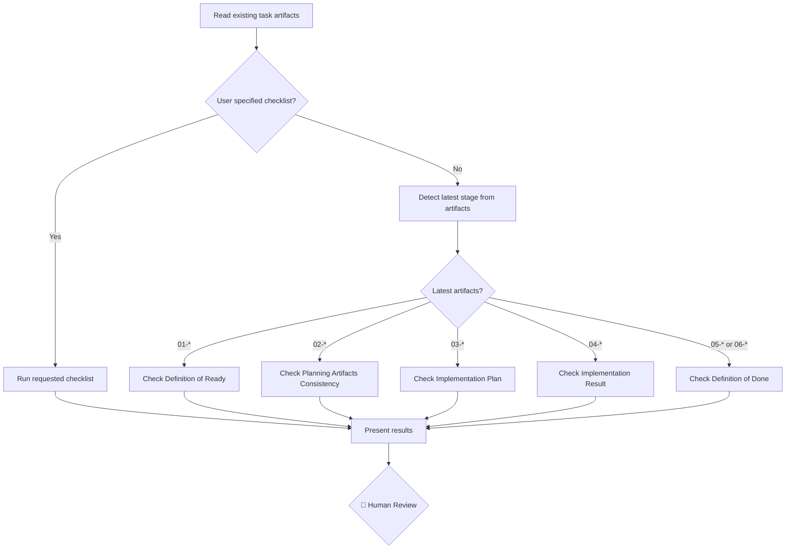

# Checklist Dispatcher

Run the appropriate QA checklist based on the current task artifacts or a specific user request. This command detects which artifacts exist and selects the right checklist, or runs a specific one when the user asks.

**Input**: The `<short-name>` of the task or the path to the task directory. Optionally, the user can specify which checklist to run (DoR, plans-consistency, implementation-plan, implementation-result, or DoD).

---

## Available Checklists

| Checklist | Skill | When to use | Required artifacts | Outcome artifacts |
|-----------|-------|-------------|-------------------|-------------------|
| **Definition of Ready** | [qa-check-definition-of-ready](../skills/qa-check-definition-of-ready/SKILL.md) | After Kickoff stage | `01-business-idea.md`, `01-implementation-scope.md` | `01-kickoff-checklist.md` |
| **Planning Artifacts Consistency** | [qa-check-plans-consistency](../skills/qa-check-plans-consistency/SKILL.md) | After Focus stage | `02-development-plan.md`, `02-testing-plan.md`, `02-automation-plan.md` | `02-focus-checklist.md` |
| **Implementation Plan** | [qa-check-implementation-plan](../skills/qa-check-implementation-plan/SKILL.md) | After Plan stage | `03-implementation-plan.md`, `03-tasks.md` | `03-plan-checklist.md` |
| **Implementation Result** | [qa-check-implementation-result](../skills/qa-check-implementation-result/SKILL.md) | After Implement stage | `03-implementation-plan.md`, `03-tasks.md`, `04-tasks-progress.md` | `05-review-summary.md` |
| **Definition of Done** | [qa-check-definition-of-done](../skills/qa-check-definition-of-done/SKILL.md) | After Polish stage | `03-implementation-plan.md`, `03-tasks.md`, `05-review-summary.md` | `06-done-checklist.md` |

---

## Workflow Diagram



---

## Steps

### Step 1 — Detect or Select Checklist

1. Read the contents of `my-specs/tasks/<short-name>/` to see which artifacts exist
2. If the user specified a checklist, use that one
3. Otherwise, select the checklist matching the **latest** workflow stage:
   - If `05-*.md` or `06-*.md` files exist → **Definition of Done**
   - If `04-*.md` files exist → **Implementation Result**
   - If `03-*.md` files exist → **Implementation Plan**
   - If `02-*.md` files exist → **Planning Artifacts Consistency**
   - If `01-*.md` files exist → **Definition of Ready**

### Step 2 — Run the Selected Checklist

Use the `Task` tool with `subagent_type: qa` to delegate to the QA Expert subagent. Instruct it to apply the appropriate checklist skill. Pass all relevant artifacts for the selected checklist.

**Definition of Ready:**
```
Using the appropriate skill, evaluate the kickoff artifacts for readiness.
```

**Planning Artifacts Consistency:**
```
Using the appropriate skill, check the consistency of all planning artifacts.
```

**Implementation Plan:**
```
Using the appropriate skill, evaluate the final implementation plan artifacts.
```

**Implementation Result:**
```
Using the appropriate skill, compare the delivered implementation against the approved plan after the implementation.
```

**Definition of Done:**
```
Using the appropriate skill, evaluate whether the feature is ready to close.
```

### Step 3 — Present Results

Present the results from the sub-agents to the user as a new checklist file named like it specified in the table above in the item `Available Checklists`, for instance:
- "Definition of Ready" -> `01-kickoff-checklist.md`
- "Planning Artifacts Consistency" -> `02-focus-checklist.md`
- "Implementation Plan" -> `03-plan-checklist.md`
- "Implementation Result" -> `05-review-summary.md`
- "Definition of Done" -> `06-done-checklist.md`

If the file with such name already exist, just overwrite it.

**🛑 Checkpoint:** The user decides how to handle any gaps — fix them now, defer them, or accept them.

---

## Rules

- This command is a dispatcher — it runs exactly one checklist per invocation
- Always use the QA subagent for checklist execution
- If required artifacts for the selected checklist are missing, tell the user what's needed
- Save the checklist output to the appropriate stage-numbered file (e.g., re-running kickoff readiness overwrites `01-kickoff-checklist.md`)
- Do not modify the checklist templates — just use output from the sub-agents to create new files with the presented results
