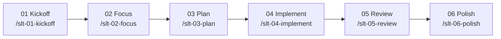

# Shift-Left Testing — Workflow Entrypoint

This is the umbrella command for the Shift-Left Testing development workflow. It detects the current progress of a task and routes you to the appropriate stage, or starts a new task from scratch.

---

## Workflow Overview

| Stage | Command | Purpose |
|-------|---------|---------|
| 01 | `/slt-01-kickoff` | Explore business idea, define scope, run readiness checklist |
| 02 | `/slt-02-focus` | Draft implementation, testing, and automation plans |
| 03 | `/slt-03-plan` | Compile final implementation plan and task list |
| 04 | `/slt-04-implement` | Execute implementation one stage at a time |
| 05 | `/slt-05-review` | Developer code review + QA implementation check |
| 06 | `/slt-06-polish` | Address follow-ups, confirm Definition of Done |
| — | `/slt-checklist` | Run the appropriate checklist for the current stage |

---

## Routing Logic

### If the user provides a task short-name

1. Read the contents of `my-specs/tasks/<short-name>/` to detect which artifacts exist
2. Determine the current stage based on the latest artifacts:

| Latest artifacts found | Current stage | Next action |
|----------------------|---------------|-------------|
| No task directory | Not started | Run `/slt-01-kickoff` |
| `01-*.md` only | Kickoff done | Run `/slt-02-focus` (requires `01-kickoff-checklist.md` passed) |
| `02-*.md` present | Focus done | Run `/slt-03-plan` (requires `02-focus-checklist.md` passed) |
| `03-*.md` present | Plan done | Run `/slt-04-implement` (requires `03-plan-checklist.md` passed) |
| `04-tasks-progress.md` present | Implementing | Check if all stages done, then `/slt-05-review` or continue `/slt-04-implement` |
| `05-*.md` present | Review done | Run `/slt-06-polish` (requires `05-review-summary.md` passed) |
| `06-done-checklist.md` present | Polish done | Feature may be complete — verify (`06-done-checklist.md` passed) |

3. **Checklist gate**: Before suggesting the next stage, verify that the checklist for the completed stage exists and has all items marked as passed (all checklist items show `[x]`):

   | Completed stage | Required checklist |
   |-----------------|--------------------|
   | Kickoff | `01-kickoff-checklist.md` |
   | Focus | `02-focus-checklist.md` |
   | Plan | `03-plan-checklist.md` |
   | Review | `05-review-summary.md` |
   | Polish | `06-done-checklist.md` |

   - If the checklist is missing or has unchecked items, **automatically run `/slt-checklist`** for the current stage to generate or refresh the checklist.

4. Tell the user what stage they're at and suggest the next command
5. If the user confirms, run the suggested workflow stage inline

### If the user describes a new business idea

1. There is no existing task directory — start from the beginning
2. Run `/slt-01-kickoff` with the provided business idea

### If the user asks for a specific stage

Run that stage directly, regardless of detected progress. Warn if prerequisite artifacts appear to be missing.

### If the user didn't provide any input

Ask the user to provide a task short-name, Jira issue URL, or describe a new business idea to start from scratch. Do not proceed until valid input is received. Do not assume defaults.

---

## Artifact Convention

All task artifacts are stored in `my-specs/tasks/<short-name>/` with stage-numbered filenames:

| Prefix | Stage | Files |
|--------|-------|-------|
| `01-` | Kickoff | `business-idea.md`, `implementation-scope.md`, `kickoff-checklist.md` |
| `02-` | Focus | `development-plan.md`, `testing-plan.md`, `automation-plan.md`, `focus-checklist.md` |
| `03-` | Plan | `implementation-plan.md`, `tasks.md`, `plan-checklist.md` |
| `04-` | Implement | `tasks-progress.md` |
| `05-` | Review | `dev-review.md`, `qa-review.md`, `review-summary.md` |
| `06-` | Polish | `done-checklist.md` |

---

## Rules

- Always detect progress before suggesting a stage
- Never skip stages silently — warn if artifacts are missing
- Each stage can be stopped and resumed independently
- The user can always ask to re-run a previous stage or run a specific checklist
- Use `/slt-checklist` to run a standalone QA check at any point
